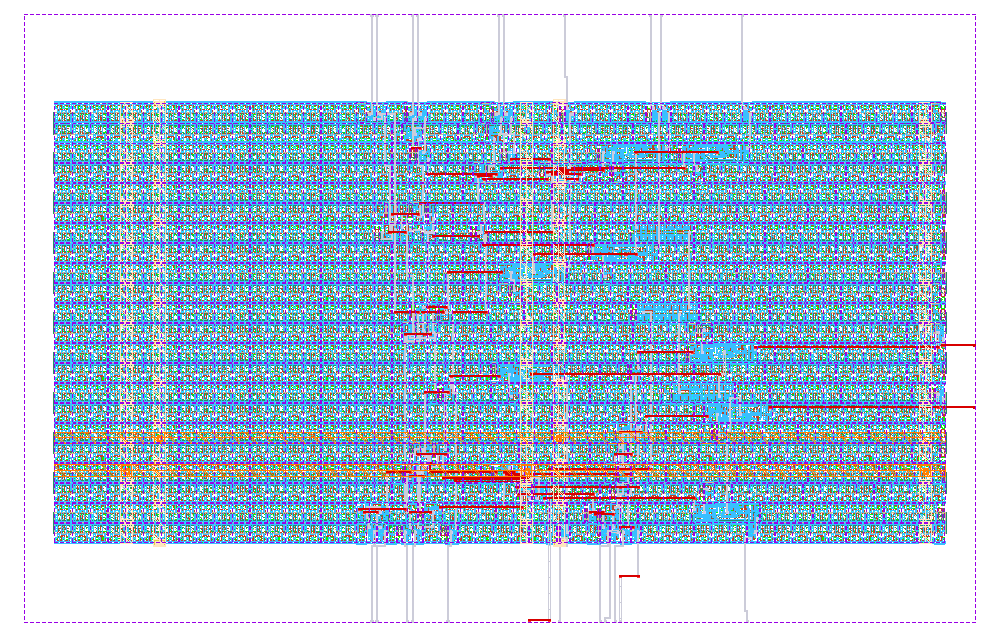

# ⚡ Design and Study of an Approximate Carry Lookahead Adder (CLA)

### *Silicluster v3 Digital-Project Call — Open-Source Silicon Submission*

[-blue.svg)](https://github.com/IHP-GmbH/IHP-Open-PDK)
[](https://github.com/The-OpenROAD-Project/OpenLane)
[-brightgreen.svg)]()
[-brightgreen.svg)]()
[-brightgreen.svg)]()
[]()
[]()

---

## 📑 Table of Contents
1. [Project Team & Contributors](#-project-team--contributors)
2. [Executive Summary & Abstract](#-executive-summary--abstract)
3. [Contest Specifications & I/O Constraints](#-contest-specifications--io-constraints)
4. [Architecture & Approximation Strategy](#-architecture--approximation-strategy)
5. [Exhaustive Verification & Error Analysis](#-exhaustive-verification--error-analysis)
6. [Synthesis & Physical Implementation Comparison](#-synthesis--physical-implementation-comparison)
7. [Physical Layout Visualizations](#-physical-layout-visualizations)
8. [Repository Directory Structure](#-repository-directory-structure)
9. [How to Run & Reproduce](#-how-to-run--reproduce)
10. [References & Acknowledgements](#-references--acknowledgements)

---

## 👥 Project Team & Contributors

* **Institution**: **Poornima Institute of Engineering and Technology, Jaipur**  
* **Course**: Digital System and Logic Design (Theory & Lab)  
* **Academic Year**: 2026  
* **Faculty Guide / Project Supervisor**: **Dr. Aditya Kumar Singh Pundir**  

| Student Name | Roll / Student ID | Role / Contribution |
| :--- | :--- | :--- |
| **Sidharth Dhankani** | PIET25CA054 | RTL Architecture, OpenLane Physical Flow & Sign-off |
| **Khanak Rathi** | PIET25CA023 | Exhaustive Verification & Testbench Design |
| **Kratika Jain** | PIET25CA024 | Logic Synthesis (Yosys) & Structural Optimization |
| **Paarth Khandelwal** | PIET25CA037 | Static Timing Analysis (STA) & Power Modeling |
| **Manvi Bhardawaj** | PIET25CA029 | Physical DRC/LVS Verification & Layout Sign-off |
| **Siddhi Patel** | PIET25CA055 | Physical Implementation & Technical Documentation |

---

## 📖 Executive Summary & Abstract

Carry Lookahead Adders (CLAs) are fundamental building blocks in microprocessors, DSP engines, and arithmetic logic units (ALUs) due to their fast logarithmic $O(\log n)$ carry propagation. However, exact carry generator structures become increasingly area-hungry and power-intensive as bit-widths grow.

In error-resilient applications such as **digital image filtering, audio signal processing, computer vision, and deep neural network (DNN) inference accelerators**, human perception and algorithmic noise-tolerance allow bounded arithmetic approximations without quality degradation.

This project implements, simulates, synthesizes, and physically tapes out an **Approximate 7-bit Carry Lookahead Adder (`approx_cla`)** alongside an **Exact 7-bit Carry Lookahead Adder (`exact_cla`)** baseline using the **IHP SG13G2 (130nm BiCMOS)** open-source PDK via the OpenLane ASIC flow.

> **Theoretical Reference**: Based on the methodology published by P. Sai Manohar et al., *"Implementation of Carry Look Ahead Adder with 2-bit Approximate Adder"*, *IEEE International Conference on Applied Artificial Intelligence and Computing (ICAAIC 2023)*.

---

## 🎯 Contest Specifications & I/O Constraints

The design adheres strictly to the constraints outlined in the **Silicluster v3 Digital-Project Call**:

| Constraint | Limit / Requirement | Project Implementation | Compliance Status |
| :--- | :--- | :--- | :---: |
| **Max Digital Inputs** | 14 inputs | 14 bits (`a[6:0]`, `b[6:0]`) + `clk`, `rst` | ✅ **Passed** |
| **Max Digital Outputs** | 14 outputs | 8 bits (`sum[7:0]`) | ✅ **Passed** |
| **Die Area Target** | 180 µm × 115 µm (20,700 µm²) | Fixed die: 180 µm × 115 µm | ✅ **Passed** |
| **Core Area** | User defined inside die | 168.48 µm × 83.16 µm (14,010.8 µm²) | ✅ **Passed** |
| **Target Clock** | 10 MHz (Period: 100 ns) | Setup Slack > +78 ns (STA Clean) | ✅ **Passed** |
| **Technology PDK** | Open-source standard cell library | IHP SG13G2 (130nm standard cells) | ✅ **Passed** |
| **Design Rules** | Zero DRC, LVS, Antenna errors | 0 DRC, 0 LVS, 0 Antenna violations | ✅ **Passed** |

---

## 📐 Architecture & Approximation Strategy

A 7-bit addition ($A[6:0] + B[6:0]$) is split into two regions:
1. **Least Significant Portion (LSP)**: 4 bits (`[3:0]`), where mathematical weights are small ($2^0$ to $2^3$).
2. **Most Significant Portion (MSP)**: 3 bits (`[6:4]`), implemented as an exact Carry Lookahead Adder stage ($2^4$ to $2^6$) to preserve high-magnitude precision and prevent catastrophic overflow.

```
                           Input Operands: A[6:0], B[6:0]
                                         │
        ┌────────────────────────────────┴────────────────────────────────┐
        ▼                                                                 ▼
┌──────────────────────────────┐                         ┌──────────────────────────────┐
│     MSP: Bits [6:4]          │                         │       LSP: Bits [3:0]        │
│  Exact 3-Bit CLA Generator   │                         │  Hybrid Approximation Block  │
└──────────────┬───────────────┘                         └──────────────┬───────────────┘
               │                                                        │
               ├─────────────────────────┐               ┌──────────────┴──────────────┐
               ▼                         ▼               ▼                             ▼
         [Carry-out C3]            [Sum S6..S4]     Bits [3:2]                    Bits [1:0]
            = Sum[7]               = Sum[6:4]     2-Bit Approx Adder            Constant Logic 1
                                                  (Carry Truncated)             (Zero Logic Gates)
```

### 1. LSP Approximation Details:
* **Bits [1:0] (Constant Output Reduction)**:
  $$S_0 = 1, \quad S_1 = 1$$
  Hardwired directly to high logic (`1'b1`). Eliminates logic gates and carry generation completely for the lower 2 bits.
* **Bits [3:2] (2-Bit Approximate Adder with Truncated Carry)**:
  $$S_2 = A_2 \oplus B_2$$
  $$S_3 = A_3 \oplus B_3 \oplus (A_2 \cdot B_2)$$
  The carry-out from bit 3 is deliberately discarded, isolating the carry network between the LSP and MSP.

### 2. MSP Exact Carry Lookahead Details:
* **Bits [6:4] (Exact 3-Bit CLA Stage)**:
  Generate ($G$) and Propagate ($P$) terms:
  $$G_i = A_i \cdot B_i, \quad P_i = A_i \oplus B_i \quad (i \in \{0, 1, 2\} \equiv \text{bits } [4, 5, 6])$$
  Fast carry lookahead chain ($C_0 = 0$):
  $$C_1 = G_0$$
  $$C_2 = G_1 + (P_1 \cdot G_0)$$
  $$C_3 = G_2 + (P_2 \cdot G_1) + (P_2 \cdot P_1 \cdot G_0)$$
  Sum equations:
  $$S_4 = P_0, \quad S_5 = P_1 \oplus C_1, \quad S_6 = P_2 \oplus C_2, \quad S_7 = C_3$$

---

## 🧪 Exhaustive Verification & Error Analysis

The design was exhaustively verified with **Icarus Verilog** and **GTKWave** across all possible input permutations:

### 1. Comprehensive Error Characterization ($128 \times 128 = 16,384$ Input Vectors)

| Statistical Parameter | Measured Value | Significance / Analysis |
| :--- | :---: | :--- |
| **Total Test Vectors** | **16,384** | Complete state space ($A \in [0, 127], B \in [0, 127]$) |
| **Reference Model Mismatches** | **0** | RTL strictly follows the intended architectural specification |
| **Inputs with Exact Match ($Error = 0$)** | **2,560 (15.6%)** | Produces mathematically exact results |
| **Maximum Absolute Error ($E_{max}$)** | **19** | Occurs at $127 + 127$ (Exact: 254, Approx: 235); **only 7.48%** of maximum sum |
| **Mean Absolute Error (MAE)** | **6.78** | Low average magnitude divergence |
| **Mean Error / Bias ($Exact - Approx$)** | **+6.0** | Systematic bounded underestimation due to truncated carry |

### 2. Sample Waveform Vectors
```text
========================================================================================
 Input A   Input B   Exact Golden Sum   Approximate Sum   Error (Exact - Approx)   Note
========================================================================================
     5         3             8                  7                  +1          Near exact
    12        10            22                  7                 +15          Bounded error
    27       100           127                127                   0          Exact match!
    64        64           128                131                  -3          Small offset
    85        42           127                127                   0          Exact match!
    99        77           176                175                  +1          Near exact
   120         5           125                127                  -2          Small offset
   127       127           254                235                 +19          Worst-case error
========================================================================================
```

---

## 📊 Synthesis & Physical Implementation Comparison

Both circuits were taken through the full **OpenLane** RTL-to-GDSII flow targeting the **IHP SG13G2 (130nm)** standard cell library under identical constraints:

| Category | Metric | Exact CLA (`exact_cla`) | Approx CLA (`approx_cla`) | Improvement / Delta |
| :--- | :--- | :---: | :---: | :---: |
| **Logic Synthesis** | **Synthesized Standard Cells** | 59 cells | **36 cells** | **-39.0% (-23 cells)** |
| *(Pre-PnR Yosys)* | **Synthesized Cell Area** | 863.65 µm² | **598.75 µm²** | **-30.7% (-264.9 µm²)** |
| | Combinational Cells | 51 cells | **29 cells** | **-43.1%** |
| | Flip-Flops (DFF) | 8 cells (391.91 µm²) | **7 cells (342.92 µm²)** | **-12.5%** |
| **Physical Layout** | **Final Post-PnR Cell Count** | 85 cells | **59 cells** | **-30.6% (-26 cells)** |
| *(Post-PnR OpenROAD)*| **Final Standard Cell Area** | 1,166.66 µm² | **878.17 µm²** | **-24.7% (-288.5 µm²)** |
| | Multi-Input Logic Cells | 48 cells | **27 cells** | **-43.8% (-21 cells)** |
| | Core Utilization | 8.33% | **6.27%** | Lower silicon congestion |
| | **Routed Wirelength** | 1,865 µm | **1,234 µm** | **-33.8% (-631 µm)** |
| | **Total Via Count** | 369 vias | **232 vias** | **-37.1% (-137 vias)** |
| **Power Consumption** | **Combinational Power** | 1.089 µW | **0.558 µW** | **-48.8% power drop** |
| *(at 1.20V, 25°C typ)* | Internal Cell Power | 9.11 µW | **8.24 µW** | **-9.5%** |
| | Switching Power | 1.73 µW | **1.45 µW** | **-16.2%** |
| | Leakage Power | 0.80 µW | **0.82 µW** | About equal |
| | **Total Core Power** | 11.64 µW | **10.51 µW** | **-9.7% total power savings** |
| **Static Timing** | Worst Setup Slack (WNS) | +77.76 ns | **+78.81 ns** | Meets timing (10 MHz) |
| *(STA Post-PnR)* | Worst Hold Slack (WNS) | +19.76 ns | **+19.70 ns** | Meets timing |
| | Slew & Cap Violations | 0 | **0** | Clean sign-off |
| **Manufacturing** | **Magic DRC** | Passed (0 errors) | **Passed (0 errors)** | 100% DRC Clean |
| **Sign-Off** | **KLayout DRC** | Passed (0 errors) | **Passed (0 errors)** | 100% DRC Clean |
| | **Netgen LVS** | Passed (LVS match) | **Passed (LVS match)** | 100% LVS Clean |
| | **Antenna Rules** | Passed (0 errors) | **Passed (0 errors)** | 100% Antenna Clean |

---

## 🖼️ Physical Layout Visualizations

### Approximate CLA (`approx_cla`)

*Figure 1: Full physical layout of `approx_cla` showing placed standard cells, power rings, and pin routing on IHP SG13G2 (130nm).*

### Exact CLA (`exact_cla`)

*Figure 2: Full physical layout of `exact_cla` baseline with dense routing channels and increased cell area.*

---

## 📁 Repository Directory Structure

```text
approx-cla-silicluster/
├── Project_Report_Approx_CLA_Final.docx  # Full comprehensive academic project report
├── config_approx.json                    # OpenLane flow configuration for approx_cla
├── config_exact.json                     # OpenLane flow configuration for exact_cla
├── RUN_2026-11-21_08-29-42/              # Full OpenLane run stages & checkpoints for approx_cla
├── RUN_2026-11-21_09-17-29/              # Full OpenLane run stages & checkpoints for exact_cla
├── layout/
│   ├── approx_cla/                       # Signoff collateral: DEF, GDS, LEF, MAG, ODB, SDC, SDF, SPEF, SPICE
│   ├── exact_cla/                        # Signoff collateral: DEF, GDS, LEF, MAG, ODB, SDC, SDF, SPEF, SPICE
│   ├── approx_cla_layout_render.png      # High-resolution PnR layout render (Approx)
│   └── exact_cla_layout_render.png       # High-resolution PnR layout render (Exact)
├── reports/
│   ├── approx_cla/                       # OpenROAD timing, routing, DRC, LVS, power & antenna reports
│   └── exact_cla/                        # OpenROAD timing, routing, DRC, LVS, power & antenna reports
├── rtl/
│   ├── approx_cla.v                      # Verilog RTL for 7-bit Approximate CLA
│   └── exact_cla.v                       # Verilog RTL for 7-bit Exact CLA
├── screenshots/                          # Demonstration captures and figures (.gitkeep)
├── sim/
│   ├── approx_cla_tb.v                   # Exhaustive error evaluation testbench (16,384 vectors)
│   ├── approx_cla_tb.vcd                 # VCD waveform dump
│   ├── wave_tb.v                         # Comparative simulation testbench
│   ├── wave_tb.vcd                       # Waveform dump for GTKWave
│   ├── wave_results.txt                  # Output logs with side-by-side verification
│   ├── compile_log.txt                   # Compilation diagnostic log
│   └── simulation_log.txt                # Simulation diagnostic log
└── synthesis/
    ├── approx_cla_stat.rpt               # Yosys cell count and area statistics (Approx)
    └── exact_cla_stat.rpt                # Yosys cell count and area statistics (Exact)
```

---

## 🚀 How to Run & Reproduce

### 1. Functional Simulation & Waveform Inspection
```bash
# Navigate to simulation directory
cd sim

# Compile and execute exhaustive testbench
iverilog -Wall -o approx_cla_sim.vvp approx_cla_tb.v ../rtl/approx_cla.v
vvp approx_cla_sim.vvp

# Compile and generate waveform trace
iverilog -Wall -o wave_sim.vvp wave_tb.v ../rtl/approx_cla.v ../rtl/exact_cla.v
vvp wave_sim.vvp

# Open waveforms in GTKWave
gtkwave wave_tb.vcd
```

### 2. Logic Synthesis & OpenLane Physical ASIC Flow
```bash
# Run physical flow for Approximate CLA
openlane --pdk sg13g2 config_approx.json

# Run physical flow for Exact CLA baseline
openlane --pdk sg13g2 config_exact.json
```

---

## 📚 References & Acknowledgements

1. **P. Sai Manohar, et al.**, *"Implementation of Carry Look Ahead Adder with 2-bit Approximate Adder"*, *2023 Second International Conference on Applied Artificial Intelligence and Computing (ICAAIC)*, Salem, India, 2023.
2. **IHP Microelectronics**, *SG13G2 Open Source 130nm BiCMOS PDK*, [IHP GitHub Repository](https://github.com/IHP-GmbH/IHP-Open-PDK).
3. **The OpenROAD Project**, *OpenLane: Open-Source Automated RTL-to-GDSII ASIC Flow*, [OpenLane GitHub](https://github.com/The-OpenROAD-Project/OpenLane).
4. **Silicluster**, *Silicluster v3 Digital-Project Call Guidelines and Tape-out Framework*.
5. Faculty guidance and mentorship from **Dr. Aditya Kumar Singh Pundir**, Department of Digital System and Logic Design, **Poornima Institute of Engineering and Technology, Jaipur**.
