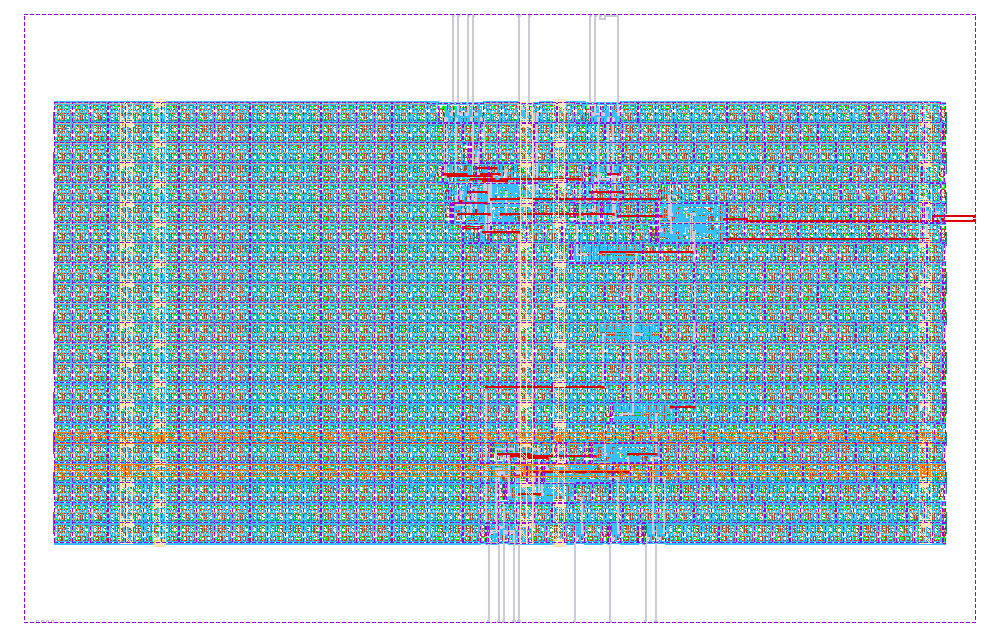

# SiliCluster Submission: Approximate vs. Exact Carry Lookahead Adder (CLA)

This repository contains the complete RTL-to-GDSII ASIC design submission for the **SiliCluster** contest, comparing an **Approximate Carry Lookahead Adder (`approx_cla`)** against an **Exact Carry Lookahead Adder (`exact_cla`)** implemented in the **IHP SG13G2 (130nm BiCMOS)** open-source technology.

---

## 📌 Project Overview

Carry Lookahead Adders (CLAs) are widely used in high-performance arithmetic units due to their fast logarithmic carry propagation. However, exact carry generator networks incur substantial silicon area and dynamic power overhead. In error-tolerant applications such as DSP, multimedia processing, neural network accelerators, and computer vision, approximate computing offers a compelling trade-off between accuracy and hardware efficiency.

In this project:
- **`exact_cla`**: Implements full exact carry lookahead generation across all operand bits.
- **`approx_cla`**: Employs a hybrid approximation architecture:
  - **Bits [1:0] (LSP)**: Hardwired constant logic (`1'b1`), eliminating lower-order carry generation.
  - **Bits [3:2] (Middle LSP)**: 2-bit approximate addition with discarded carry propagation.
  - **Bits [6:4] (MSP)**: Exact 3-bit Carry Lookahead generator ensuring bounded upper-magnitude precision.

---

## 📊 Key Synthesis & Physical Design Results

Synthesized and placed/routed targeting the **IHP SG13G2 (130nm)** standard cell library:

| Metric | Approximate CLA (`approx_cla`) | Exact CLA (`exact_cla`) | Improvement / Delta |
| :--- | :---: | :---: | :---: |
| **Cell Count** | **36 cells** | 59 cells | **39.0% fewer cells** |
| **Synthesis Cell Area** | **598.752 µm²** | 863.654 µm² | **30.7% area reduction** |
| **Sequential Elements** | 7 flip-flops (342.92 µm²) | 8 flip-flops (391.91 µm²) | Lower register overhead |
| **Die Area Target** | 180 µm × 115 µm | 180 µm × 115 µm | Equal footprint constraint |

---

## 🖼️ Physical Layout Renders

### Approximate CLA (`approx_cla`)


### Exact CLA (`exact_cla`)


---

## 📁 Repository Structure

```text
├── rtl/
│   ├── approx_cla.v               # Verilog RTL for 7-bit Approximate CLA
│   └── exact_cla.v                # Verilog RTL for 7-bit Exact CLA
├── sim/
│   ├── approx_cla_tb.v            # Testbench for comprehensive error simulation
│   ├── approx_cla_tb.vcd          # VCD waveform dump
│   ├── wave_tb.v                  # Comparative waveform testbench
│   ├── wave_tb.vcd                # Comparative waveform dump
│   ├── wave_results.txt           # Sample test vector output & error metrics
│   ├── compile_log.txt            # Icarus Verilog compilation log
│   └── simulation_log.txt         # Simulation runtime log
├── synthesis/
│   ├── approx_cla_stat.rpt        # Yosys cell count and area report (Approx)
│   └── exact_cla_stat.rpt         # Yosys cell count and area report (Exact)
├── layout/
│   ├── approx_cla/                # Full OpenLane output collateral (DEF, GDS, LEF, MAG, ODB, SDC, SDF, SPEF, SPICE)
│   ├── exact_cla/                 # Full OpenLane output collateral (DEF, GDS, LEF, MAG, ODB, SDC, SDF, SPEF, SPICE)
│   ├── approx_cla_layout_render.png
│   └── exact_cla_layout_render.png
├── reports/
│   ├── approx_cla/                # OpenRoad timing, routing, DRC, and manufacturing reports
│   └── exact_cla/                 # OpenRoad timing, routing, DRC, and manufacturing reports
├── config_approx.json             # OpenLane flow configuration for approx_cla
├── config_exact.json              # OpenLane flow configuration for exact_cla
└── Project_Report_Approx_CLA_Final.docx # Comprehensive project report documentation
```

---

## 🔬 Simulation & Verification

The designs were verified with Icarus Verilog and GTKWave. Representative error evaluation demonstrates bounded error characteristics:

```text
a=  5 b=  3  exact=  8  approx=  7  error= 1
a= 12 b= 10  exact= 22  approx=  7  error= 15
a= 27 b=100  exact=127  approx=127  error= 0
a= 64 b= 64  exact=128  approx=131  error=-3
a= 85 b= 42  exact=127  approx=127  error= 0
a= 99 b= 77  exact=176  approx=175  error= 1
a=120 b=  5  exact=125  approx=127  error=-2
a=127 b=127  exact=254  approx=235  error= 19
```

---

## 🛠️ Tools & Technologies

- **PDK**: IHP Open Source SG13G2 (130nm BiCMOS)
- **RTL Simulation**: Icarus Verilog (`iverilog`), GTKWave
- **Synthesis**: Yosys Open SYnthesis Suite
- **Place & Route / ASIC Flow**: OpenLane / OpenROAD
- **Physical Verification**: Magic, KLayout
